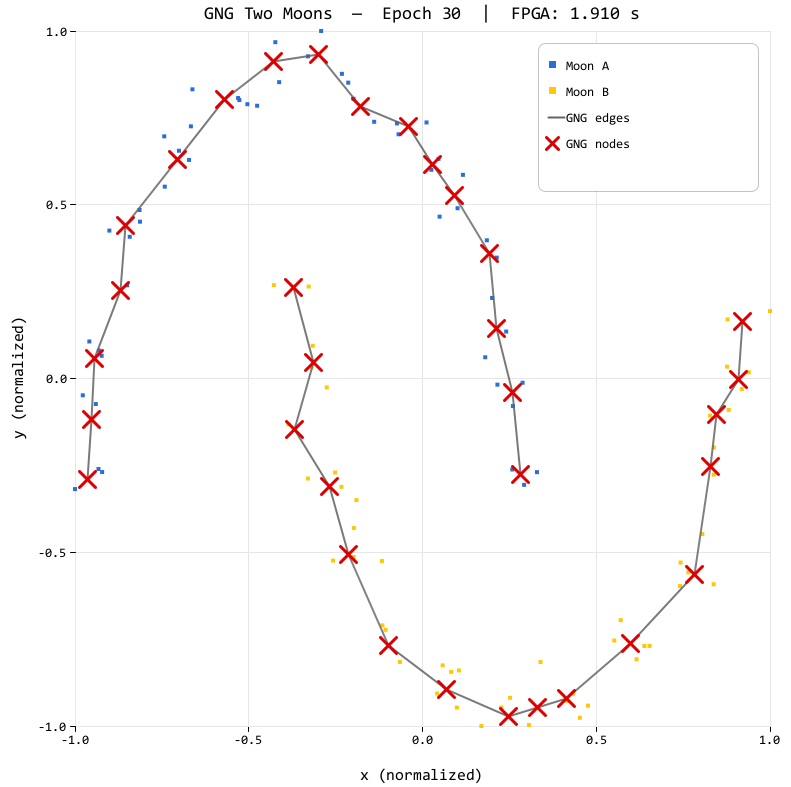
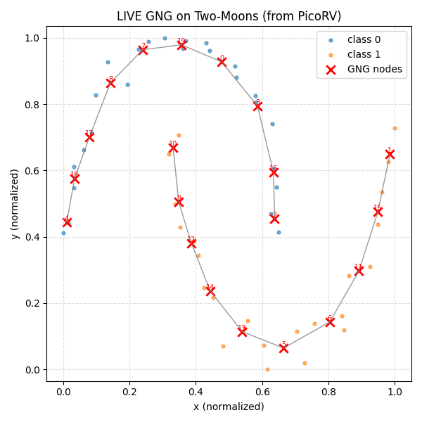

# fpga_gng

Growing Neural Gas (GNG) implementations on a low-cost Gowin FPGA (Tang Nano 9K), using RISC-V soft-core CPUs (PicoRV32 and NEORV32) and VHDL hardware accelerators.

**[View Project Website](https://tzf230201.github.io/fpga_gng/)**

**[View Presentation Slides](https://tzf230201.github.io/fpga_gng/slides/)**

All webpage materials are in [`web_page/`](web_page/), including the project page, images, publication downloads, Slidev sources, and web report. See the [webpage guide](web_page/README.md) for the folder layout and build instructions.



# 📁 GNG Implementations

| Folder | Description |
| ------ | ----------- |
| [`gng_neorv32`](gng_neorv32/) | Full CPU GNG on embedded (GNG runs entirely as firmware on the NEORV32 RISC-V CPU) |
| [`gng_neorv32_accelerator_V2`](gng_neorv32_accelerator_V2/) | Full FPGA GNG (GNG implemented entirely in VHDL) |
| [`gng_neorv32_accelerator_V3`](gng_neorv32_accelerator_V3/) | Combination of FPGA and CPU GNG (hardware-software co-design) |

# Datasets

The experiment datasets are available directly in [`web_page/publication_materials/`](web_page/publication_materials/):

- [Two Moons CSV](web_page/publication_materials/dataset_two_moons.csv)
- [Concentric Circles CSV](web_page/publication_materials/dataset_concentric_circle.csv)


# 📄 Citation

If you use this work, please cite:

> T. Z. Fatahillah, R. A. Rochmanto, A. F. Aji, A. Risnumawan, C. Z. Siow, and N. Kubota, "Edge-Cell Graph Encoding and Fixed-Point Arithmetic for FPGA Growing Neural Gas," in *2026 International Joint Conference on Neural Networks (IJCNN)*, 2026, doi: [10.1109/IJCNN69854.2026.11728420](https://doi.org/10.1109/IJCNN69854.2026.11728420).

```bibtex
@inproceedings{fatahillah2026edgecell,
  author    = {Fatahillah, Teuku Zikri and Rochmanto, Raditya Artha and Aji, Achmad Fahrul and Risnumawan, Anhar and Siow, Chyan Zheng and Kubota, Naoyuki},
  title     = {Edge-Cell Graph Encoding and Fixed-Point Arithmetic for {FPGA} Growing Neural Gas},
  booktitle = {2026 International Joint Conference on Neural Networks (IJCNN)},
  year      = {2026},
  doi       = {10.1109/IJCNN69854.2026.11728420}
}
```

---
# Setup for PicoRV and NeoRV32

## 📘 Build & Flash Firmware on Windows (MSYS2 + MinGW64 + xPack RISC-V Toolchain)

This guide applies to the [`gng_picotiny`](gng_picotiny/) (PicoRV32) project and covers:

1. Installing **MSYS2**
2. Updating the MSYS2 package database
3. Installing the **MinGW64 build tools**
4. Installing **Python (MinGW64)**
5. Installing **pyserial**
6. Installing the **xPack RISC-V Embedded GCC** toolchain
7. Cloning the repository
8. Configuring the Makefile to use the correct Python interpreter
9. Building the firmware
10. Flashing the firmware with `make program`
11. Visualizing the results with **Processing 4.4.10**

---

### 🧰 1. Install MSYS2

Download the installer from:

👉 [https://www.msys2.org/](https://www.msys2.org/)

Install it with the default settings.

After installation, open the **MSYS2 MinGW64** terminal (not MSYS or UCRT64).

---

### 🔄 2. Update the MSYS2 Package Database

Run:

```
pacman -Syu
```

Close MSYS2, reopen the MinGW64 terminal, and run the same command again:

```
pacman -Syu
```

---

### 🛠️ 3. Install the MinGW64 Build Tools

```
pacman -S --needed base-devel
pacman -S --needed mingw-w64-x86_64-toolchain
```

Verify the installation:

```
make --version
gcc --version
```

---

### 🐍 4. Install Python (MinGW64 Version)

```
pacman -S mingw-w64-x86_64-python
```

Verify the installation:

```
/mingw64/bin/python --version
```

---

### 🔌 5. Install pyserial (Required for Flashing via the COM Port)

```
pacman -S mingw-w64-x86_64-python-pyserial
```

Verify the installation:

```
/mingw64/bin/python -c "import serial; print('OK')"
```

If it prints `OK`, pyserial is installed correctly.

---

### 🧩 6. Install the xPack RISC-V Embedded GCC (Required Compiler)

Download the toolchain from:

👉 [https://github.com/xpack-dev-tools/riscv-none-elf-gcc-xpack/releases](https://github.com/xpack-dev-tools/riscv-none-elf-gcc-xpack/releases)

Choose the Windows `.zip` release (not an installer) and extract it, for example to:

```
C:\xpack-riscv-none-elf-gcc-15.2.0-1
```

This is the default `RISCV_PATH` in the Makefile. If you extract it somewhere else, update `RISCV_PATH` in [gng_picotiny/Makefile](gng_picotiny/Makefile) or pass it on the command line (`make RISCV_PATH=...`).

Then add the `bin` folder to your PATH inside MSYS2. Open `~/.bashrc`:

```
nano ~/.bashrc
```

Add this line:

```
export PATH="/c/xpack-riscv-none-elf-gcc-15.2.0-1/bin:$PATH"
```

Reload the file:

```
source ~/.bashrc
```

Verify the installation:

```
riscv-none-elf-gcc --version
```

You should see the xPack GCC version information.

---

### 📂 7. Clone the Repository

```
git clone https://github.com/tzf230201/fpga_gng.git
cd fpga_gng/gng_picotiny
```

---

### 🐍 8. Configure the Makefile to Use the Correct Python

MSYS2 provides two Python interpreters:

| Interpreter        | Path                  | pyserial support |
| ------------------ | --------------------- | ---------------- |
| **MSYS Python**    | `/usr/bin/python`     | ❌ does not work |
| **MinGW64 Python** | `/mingw64/bin/python` | ✔ works          |

The Makefile must use the MinGW64 interpreter. [gng_picotiny/Makefile](gng_picotiny/Makefile) already sets it by default:

```
PYTHON_NAME ?= /mingw64/bin/python
```

If your Python is installed elsewhere, change this line or override it on the command line (see step 10).

---

### 🏗️ 9. Build the Firmware

```
make
```

The firmware image is generated at:

```
fw/fw-flash/build/fw-flash.v
```

---

### 🔥 10. Flash the Firmware

Connect your RP2040/PicoTiny board via USB (COM port), then run:

```
make program COMx=COM14
```

Replace `COM14` with your actual port (the default is `COM1`).

If needed, override the Python interpreter as well:

```
make PYTHON_NAME=/mingw64/bin/python COMx=COM14 program
```

Or run the programmer script directly:

```
/mingw64/bin/python sw/pico-programmer.py fw/fw-flash/build/fw-flash.v COM14
```

---

### 📊 11. Visualize with Processing

Install [Processing 4.4.10](https://processing.org/download), then open the sketch in the `processing_gng_dataset` folder of the implementation you are using (for example [gng_neorv32/processing_gng_dataset](gng_neorv32/processing_gng_dataset/)). Set `PORT_NAME` in the sketch to your COM port before running it. The sketch sends the dataset to the board over UART and plots the GNG result.

---

## GNG Result on FPGA (PicoRV32)



---

## 🧠 NEORV32 Notes

### About NEORV32

[NEORV32](https://github.com/stnolting/neorv32) is an FPGA-based RISC-V CPU by Stephan Nolting. It is highly customizable: you can choose how many UARTs, PWM outputs, SPI interfaces, and other peripherals the processor includes. These notes describe how it is used on a Gowin FPGA (Tang Nano 9K).

### Getting NEORV32

This project currently uses NEORV32 **v1.12.5**. Clone it into the repository root:

```
git clone https://github.com/tzf230201/fpga_gng.git
cd fpga_gng
git clone https://github.com/stnolting/neorv32.git
```

To use exactly the same version, download the ZIP from the release page below, extract it into the repository root, and rename the folder to `neorv32`:

```
https://github.com/stnolting/neorv32/releases/tag/v1.12.5
```

### Building and Uploading the Firmware

```
cd gng_neorv32/fw
make exe
python3 uart_upload.py /dev/ttyUSB0 neorv32_exe.bin
```

On Windows, replace `/dev/ttyUSB0` with your COM port (for example `COM14`).

### Boot Options

NEORV32 is written entirely in VHDL, and the processor design contains no non-volatile memory. A program can therefore be loaded in one of three ways:

| Boot method | Advantage | Disadvantage |
| ----------- | --------- | ------------ |
| **UART boot** | Fast: only compile and send over UART | The program is lost when power is removed |
| **Embedded in HDL** | The program survives a power loss | Slow: every code change requires converting the `.bin` to HDL and re-running synthesis and place-and-route |
| **External memory** (SPI flash, microSD card, etc.) | The program survives a power loss and can be updated without re-synthesis | Requires an extra memory device |

The best option is to store the program in non-volatile memory. Fortunately, Gowin FPGAs include an internal **user flash (UFlash)** that can hold the program uploaded over UART.

### Booting from User Flash

To boot from user flash when no UART upload is in progress, the bootloader in [gng_neorv32/bootloader](gng_neorv32/bootloader/) was modified. It adds an **erase** function, which did not exist before, to clear the flash before a new firmware image is written. `uart_upload.py` was updated accordingly to trigger the erase.

The most important parameters are:

1. Base address
2. Page size
3. Number of UFlash pages

These values must match the UFlash configuration in the top-level VHDL file. When porting to another board, update both files.

In [gng_neorv32/bootloader/main.c](gng_neorv32/bootloader/main.c):

```
#define UFLASH_BASE_ADDR  ((uint32_t)0x00000000u)
#define UFLASH_PAGE_SIZE  ((uint32_t)2048u)
#define UFLASH_NUM_PAGES  ((uint32_t)38u)
```

In the top-level VHDL file ([gng_neorv32/gng_gowin_project/src/tang_nano_9k.vhd](gng_neorv32/gng_gowin_project/src/tang_nano_9k.vhd)):

```
    UFLASH_BASE : std_logic_vector(31 downto 0) := x"00000000";
    UFLASH_END : std_logic_vector(31 downto 0) :=  x"00013000" -- 38 pages * 2048 bytes
```

### Memory Size Configuration

The ROM (IMEM) and RAM (DMEM) sizes in the firmware makefile ([gng_neorv32/fw/makefile](gng_neorv32/fw/makefile)) must match the VHDL settings. Because the program runs from user flash, the IMEM size in the top-level VHDL file is 0, and the ROM size follows the UFlash size instead.

```
# Adjust processor IMEM size
USER_FLAGS += -Wl,--defsym,__neorv32_rom_size=72k

# Adjust processor DMEM size
USER_FLAGS += -Wl,--defsym,__neorv32_ram_size=16k
```

## Credits

- [Stephan Nolting (stnolting)](https://github.com/stnolting) created [NEORV32](https://github.com/stnolting/neorv32), the RISC-V soft-core used in this repository's CPU-based and hybrid GNG implementations.
- [jimmyw/tang_nano_9k_neorv32](https://github.com/jimmyw/tang_nano_9k_neorv32) was the reference for running NEORV32 on the Tang Nano 9K. Parts of it are no longer compatible with newer NEORV32 versions (especially the bootloader), so this project builds a new setup that aims to be more Arduino-like.
- [grughuhler/picorv32_tang_nano_unified](https://github.com/grughuhler/picorv32_tang_nano_unified) provided the original version of `uart_upload.py`, which was modified here to work with the newer bootloader.

Many thanks to all contributors.
